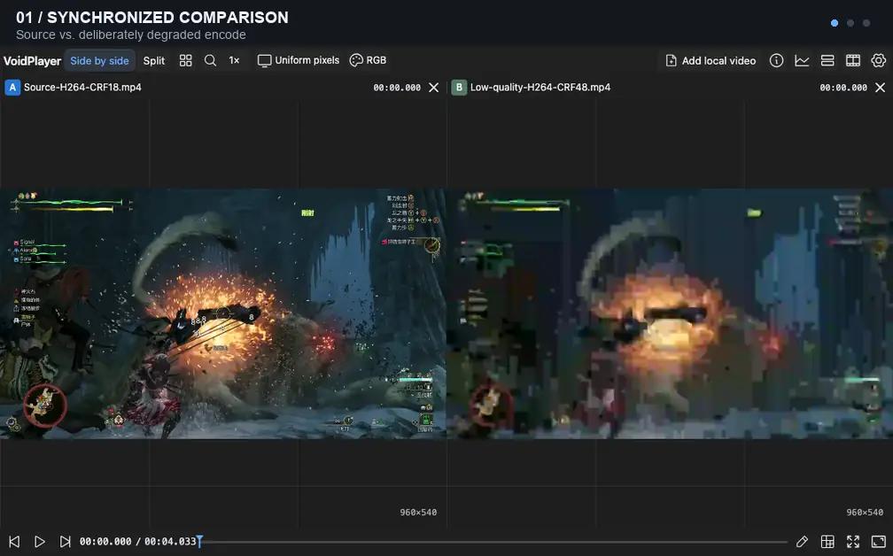

<p align="center">
  
</p>

<h1 align="center">VoidPlayer Web</h1>

<p align="center">Compare, inspect and annotate videos in your browser.</p>

<p align="center">
  <a href="https://voidplayer-local-review.akanemeguri1296.chatgpt.site/">Try online</a> ·
  <a href="https://github.com/Nakiha/VoidPlayer-Web/releases/latest">Download</a> ·
  <a href="docs/README.md">Documentation</a> ·
  <a href="https://github.com/Nakiha/VoidPlayer-Web/issues">Report an issue</a>
</p>

<p align="center">
  <a href="https://github.com/Nakiha/VoidPlayer-Web/actions/workflows/checks.yml"></a>
  <a href="LICENSE"></a>
</p>

<p align="center"><a href="README.md">简体中文</a> · English</p>

VoidPlayer Web is a video review tool for comparing encodes or processing results, inspecting individual frames, and documenting issues with text and vector annotations. Local videos are read and decoded in your browser without being uploaded.



*Compare high-quality and deliberately degraded encodes of the same clip, mark an issue, then inspect bitrate and coding blocks. Recorded from the application; animated WebP.*

## Try online

**[Open VoidPlayer →](https://voidplayer-local-review.akanemeguri1296.chatgpt.site/)**

No installation or sign-in required. Choose or drop local videos to get started:

1. Add videos and play them on a shared timeline. Use the left and right arrow keys to step through frames.
2. Pause to annotate a frame, or open track information, pixel tools and bitstream analysis.
3. Export your review from **Settings → Workspace**. To reopen it later, select the workspace file together with the original videos.

Workspace files do not contain videos. Local recovery depends on browser storage and file permissions; export important reviews as backups.

## Features

- **Multi-track comparison:** synchronize up to eight tracks (A–H), with side-by-side, grid and two-track wipe views, track ordering and timing offsets.
- **Frame inspection:** step forward or backward, seek, pan and zoom, sample pixels and capture screenshots.
- **Review annotations:** text and vector drawings, replies, resolved states, annotation cards and frame thumbnails.
- **Media analysis:** codec and color information, bitrate and packet statistics, plus NAL, GOP, reference and block/QP analysis within the supported codec scope.
- **Browser decoding:** WebCodecs where supported, with FFmpeg WASM software decoding for unsupported codec combinations.
- **Chinese and English UI:** light, dark and custom themes, with keyboard shortcuts for common actions.

Playback is muted by default. You can explicitly enable audio for one track; audio uses data already cached during video reads. See [audio behavior](docs/opportunistic-audio.md). Codec, analysis and HDR capabilities depend on the source and runtime environment; see [architecture](docs/architecture.md) and [HDR support](docs/hdr-support.md).

## Choose a version

| | Online | Local package / self-hosted |
| --- | --- | --- |
| Local videos, multi-track comparison, annotations and analysis | Yes | Yes |
| Workspace files and local recovery | Yes | Yes |
| Server media library, directory browsing and file management | — | Yes |
| Server workspaces, sharing and annotation synchronization | — | Yes |
| Desktop installation and offline resources | — | Browser-dependent |

The online version currently uses single-threaded WASM. High-resolution, multi-track software decoding performance depends on your device and source files. To deploy your own static version, see [Sites distribution](deploy/sites.md).

For a media library or shared reviews, download a package for your platform from [Releases](https://github.com/Nakiha/VoidPlayer-Web/releases/latest), extract it and start the application:

```sh
./voidplayer
# Windows: run voidplayer.exe
```

Open `http://127.0.0.1:5180/`. The package requires no Node.js, Bun or FFmpeg installation. Data is stored in a `data/` directory beside the executable. See the [standalone guide](deploy/standalone.md) for library configuration, LAN HTTPS and updates, or [desktop installation and offline use](deploy/web-app.md).

## Development

Requires **Node.js 24+**. Playback and analysis cores come from the separate [VoidPlayer-FFmpeg-Build](https://github.com/Nakiha/VoidPlayer-FFmpeg-Build/tree/wasm) repository. This repository consumes pinned artifacts rather than building WASM itself.

Prepare the core artifacts, then run:

```sh
npm ci
bash scripts/sync-wasm-core.sh
bash scripts/sync-analysis-core.sh
cp voidplayer.config.example.json voidplayer.config.json
npm run dev
```

The sync scripts read artifacts from the neighboring decoder repository by default. Override the directories with `WASM_CORE_DIR` and `ANALYSIS_CORE_DIR`. Set `mediaRoots` in the configuration to your media directories. To populate the default QA sample directory, run `bash scripts/sync-samples.sh`.

The development page defaults to `http://127.0.0.1:5178/`, with the media API on port `5180`.

| Command | Purpose |
| --- | --- |
| `npm run build` | Build the full frontend |
| `npm run serve` | Start the media service and serve the published frontend |
| `npm run dev:sites` | Develop the static, local-file version |
| `npm run package:sites` | Generate the static project, distribution archive and checksums |
| `npm run test:fast` | Run checks that require no media, cores or browser |

See [release operations](deploy/operations.md#只发布前端) for production builds and frontend updates, and [testing](docs/testing.md) for the full matrix and prerequisites.

## Documentation and contributions

The UI supports English; most detailed documentation is currently in Chinese.

- [Documentation index](docs/README.md): feature contracts, deployment and focused guides.
- [Architecture](docs/architecture.md) · [Color pipeline](docs/color-pipeline.md) · [Workspace format](docs/workspace-format.md).
- [HTTP Agent API](docs/agent-http.md) · [Local page bridge](docs/local-mcp-page-bridge.md).
- [Themes](src/themes/README.md) · [Localization](docs/localization.md) · [Icon assets](design/README.md).

[Issues](https://github.com/Nakiha/VoidPlayer-Web/issues) and pull requests are welcome. For playback issues, include your browser, operating system, container/codec and reproduction steps. You can download logs from the application. Read [AGENTS.md](AGENTS.md) before contributing code and run checks appropriate to your changes.

## License

[LGPL-2.1-or-later](LICENSE). Third-party dependencies retain their own licenses, available under **Settings → About**.
