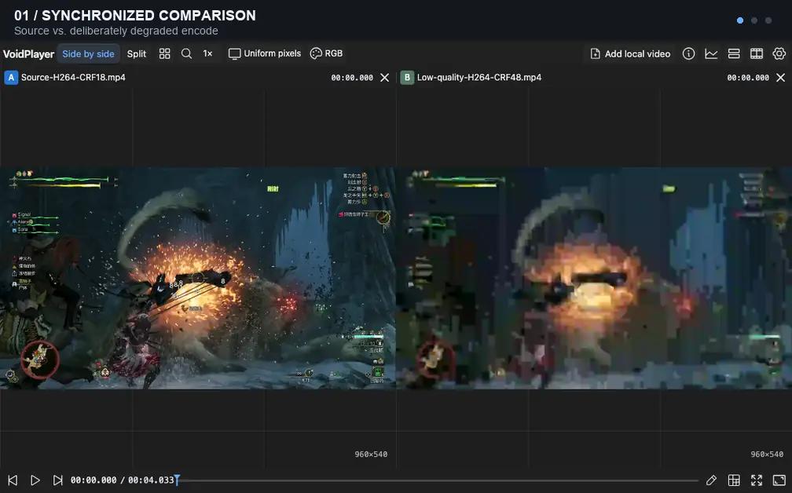

<p align="center">
  
</p>

<h1 align="center">VoidPlayer Web</h1>

<p align="center">在浏览器里同步播放、逐帧对比和标注视频。</p>

<p align="center">
  <a href="https://voidplayer-local-review.akanemeguri1296.chatgpt.site/">在线使用</a> ·
  <a href="https://github.com/Nakiha/VoidPlayer-Web/releases/latest">下载运行包</a> ·
  <a href="docs/README.md">文档</a> ·
  <a href="https://github.com/Nakiha/VoidPlayer-Web/issues">反馈问题</a>
</p>

<p align="center">
  <a href="https://github.com/Nakiha/VoidPlayer-Web/actions/workflows/checks.yml"></a>
  <a href="LICENSE"></a>
</p>

<p align="center">简体中文 · <a href="README.en.md">English</a></p>

VoidPlayer Web 是一个视频评审工具，适合对比不同编码或处理结果、检查具体帧，并用文字和矢量图形记录问题。本地视频由浏览器读取和解码，无需上传。



*同源高画质与刻意劣化的编码对比 → 圈画问题 → 查看码率和编码块。应用实录，动态 WebP。*

## 在线使用

**[打开 VoidPlayer →](https://voidplayer-local-review.akanemeguri1296.chatgpt.site/)**

无需安装或登录。视频显示要求浏览器与设备提供可用的 WebGPU，并通过 HTTPS 或 localhost 访问；不支持时会明确提示。打开网页后，选择或拖入本地视频即可开始：

1. 添加要对比的视频，在同一时间轴上播放；用左右方向键逐帧查看。
2. 暂停后添加标注，或打开轨道信息、像素工具和码流分析。
3. 地址栏记录观看状态；自托管版可点击分享，生成带 ABI 的压缩链接。标注独立属于片源版本。

本地文件引用不包含视频字节；重新打开仍需本机文件授权。在线本地文件版不调用服务器标注或分享接口。

## 能做什么

- **多轨对比**：最多八轨（A–H）同步播放，支持并排、网格、双轨分屏擦拭、轨道排序和时间偏移。
- **逐帧检查**：前后逐帧、时间定位、平移缩放、像素取样与截图。
- **评审标注**：文字和矢量绘图、回复与解决状态、标注卡片及帧缩略图。
- **媒体分析**：编码与色彩信息、码率和包统计，以及支持范围内的 NAL、GOP、参考关系和块/QP 分析。
- **浏览器解码**：优先使用 WebCodecs，不支持的编码组合通过 FFmpeg WASM 软件解码。
- **中英文界面**：亮色、暗色和自定义主题，常用操作支持快捷键。

默认静音，可显式开启单轨声音；音频只利用视频读取时已有的缓存。具体边界见[音频说明](docs/opportunistic-audio.md)。编码、分析和 HDR 能力取决于片源与运行环境，详见[架构说明](docs/architecture.md)和 [HDR 支持](docs/hdr-support.md)。

## 选择使用方式

| | 在线版 | 本地运行包 / 自托管 |
| --- | --- | --- |
| 本地视频、多轨对比、标注与分析 | 支持 | 支持 |
| URI 观看状态 | 支持，本地文件需授权 | 支持 |
| 服务器媒体库、目录浏览与文件管理 | — | 支持 |
| ABI 压缩分享与片源版本标注同步 | — | 支持 |
| 桌面安装与离线资源准备 | — | 支持，取决于浏览器 |

在线版当前使用单线程 WASM，高分辨率、多轨软件解码的速度取决于设备和片源。部署自己的静态版本见 [Sites 使用与分发](deploy/sites.md)。

需要媒体库或共享评审时，从 [Releases](https://github.com/Nakiha/VoidPlayer-Web/releases/latest) 下载对应平台的运行包，解压后启动：

```sh
./voidplayer
# Windows：运行 voidplayer.exe
```

打开 `http://127.0.0.1:5180/`。运行包无需安装 Node.js、Bun 或 FFmpeg，数据保存在程序旁边的 `data/`。媒体库配置、局域网 HTTPS 和更新步骤见[便携运行说明](deploy/standalone.md)；桌面安装见[安装与离线使用](deploy/web-app.md)。

## 开发

需要 **Node.js 24+**。播放 core 和分析 core 来自独立的 [VoidPlayer-FFmpeg-Build](https://github.com/Nakiha/VoidPlayer-FFmpeg-Build/tree/wasm) 仓库，本仓库消费固定产物，不在这里编译 WASM。

先准备好 core 产物，再运行：

```sh
npm ci
bash scripts/sync-wasm-core.sh
bash scripts/sync-analysis-core.sh
cp voidplayer.config.example.json voidplayer.config.json
npm run dev
```

同步脚本默认从相邻的解码器仓库读取产物，也可分别通过 `WASM_CORE_DIR`、`ANALYSIS_CORE_DIR` 指定目录。配置中的 `mediaRoots` 指向本机媒体目录；默认 QA 样片目录可通过 `bash scripts/sync-samples.sh` 填充。

开发页面默认位于 `http://127.0.0.1:5178/`，媒体 API 位于 `5180`。

| 命令 | 用途 |
| --- | --- |
| `npm run build` | 构建完整版前端 |
| `npm run serve` | 启动媒体服务，提供已发布的前端 |
| `npm run dev:sites` | 开发仅使用本地文件的静态版 |
| `npm run package:sites` | 生成静态项目、分发归档和校验和 |
| `npm run test:fast` | 运行无需媒体、core 或浏览器的快速检查 |

正式构建与前端更新见[发布操作](deploy/operations.md#只发布前端)；完整测试矩阵和准备条件见[验证说明](docs/testing.md)。

## 文档与参与

- [文档导航](docs/README.md)：功能契约、部署与专项说明。
- [架构](docs/architecture.md) · [色彩链路](docs/color-pipeline.md) · [URI 状态与 ABI 分享](docs/uri-state.md)。
- [HTTP Agent 接口](docs/agent-http.md) · [本机页面桥](docs/local-mcp-page-bridge.md)。
- [主题开发](src/themes/README.md) · [本地化](docs/localization.md) · [图标资源](design/README.md)。

欢迎提交 [Issue](https://github.com/Nakiha/VoidPlayer-Web/issues) 和 Pull Request。报告播放问题时，请说明浏览器、系统、片源的封装/编码及复现步骤；日志可从应用内下载。提交代码前请阅读 [AGENTS.md](AGENTS.md) 并运行改动对应的检查。

## 许可证

[LGPL-2.1-or-later](LICENSE)。第三方依赖保留各自许可证，可在应用内「设置 → 关于」查看。
